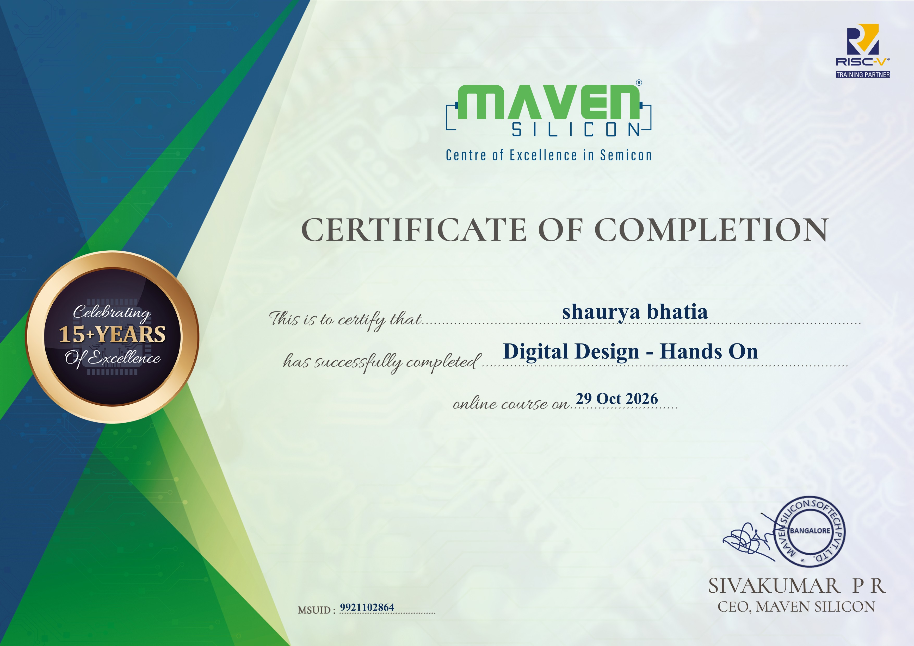

# 📜 Digital Design - Hands On

**Issued by:** [Maven Silicon](https://www.maven-silicon.com/) (Centre of Excellence in Semicon • RISC-V Training Partner)  
**Recipient:** **Shaurya Bhatia**  
**Issue Date:** October 29, 2026  
**Credential ID / MSUID:** `9921102864`  
**Signatory:** Sivakumar P R (CEO, Maven Silicon)

---

## 🎖️ Certificate Preview

  

  <a href="./Certificate.pdf"><b>📥 Download Official Certificate (PDF)</b></a> • 
  <a href="./Certificate.png"><b>🖼️ View High-Resolution PNG</b></a>

---

## 📖 Course Overview & Competencies

The **Digital Design - Hands On** curriculum by Maven Silicon provides a rigorous, hands-on foundation in digital electronic systems, RTL architecture, and hardware modeling principles used in semiconductor and VLSI engineering.

### Key Knowledge Areas:
- **Combinational Logic Design:** Boolean algebra simplification, multiplexers, demultiplexers, priority encoders, decoders, arithmetic logic circuits (adders/subtractors).
- **Sequential Logic Systems:** Latches, Edge-Triggered Flip-Flops (D, JK, T), synchronous & asynchronous counters, shift registers, and timing parameters ($t_{setup}, t_{hold}, t_{cq}$).
- **Finite State Machine (FSM) Modeling:** Mealy vs. Moore state machines, state encoding strategies, state minimization, and glitch-free state transitions.
- **Hardware Description Concepts:** Register Transfer Level (RTL) design abstractions, Verilog HDL constructs, structural vs. behavioral modeling, and testbench generation.
- **Semiconductor & RISC-V Foundation:** Introduction to modern compute architectures, hardware synthesis workflows, and logic verification methodologies.

---

## 🗂️ Verification Metadata

| Field | Detail |
|---|---|
| **Learner Name** | Shaurya Bhatia |
| **Certification** | Digital Design - Hands On |
| **Issuer** | Maven Silicon Softech Pvt. Ltd., Bangalore |
| **Industry Partner** | RISC-V International Partner |
| **MSUID** | `9921102864` |
| **Date of Completion** | 29 Oct 2026 |
| **Verification Status** | Verified & Validated |
